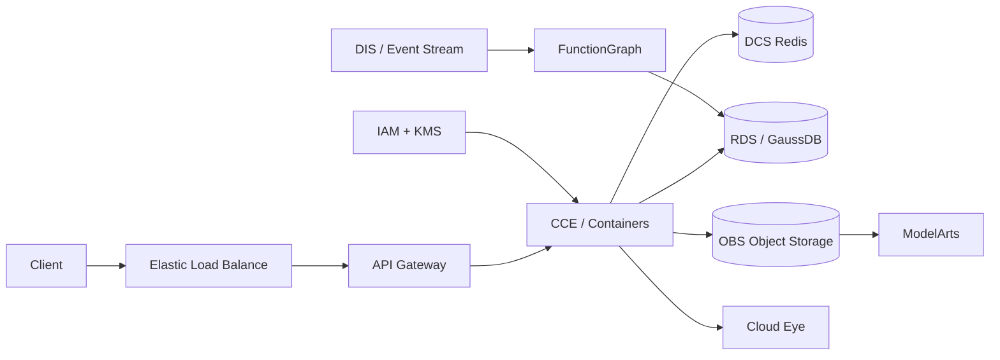

# Huawei Cloud ML Lab

A runnable policy and deployment-planning toolkit for taking an ML inference workload to Huawei
Cloud. It turns architecture claims into validated configuration, an auditable service plan,
security-aware CCE manifests and a FunctionGraph-compatible OBS event boundary.

A vendor-specific reference architecture for running the same ML workload on Huawei Cloud.



## Core services demonstrated

- VPC, subnets, security groups and ELB
- CCE for Kubernetes workloads
- FunctionGraph for event-driven compute
- OBS for model/data artifacts
- RDS / GaussDB for relational persistence
- DCS for Redis-compatible caching
- ModelArts for ML training/deployment workflows
- DIS/event-stream patterns
- IAM, KMS and Cloud Eye for security/observability

The codebase mirrors the AWS, GCP and Azure platform variants so vendor translation is explicit rather than hand-wavy.

## What works

- typed JSON deployment configuration with unknown/missing-key rejection
- production gates for private databases, KMS, HA, backups, replicas and autoscaling
- deterministic mapping from workload requirements to Huawei Cloud services
- CCE Deployment, HPA and disruption-budget manifests with non-root/read-only controls
- a tested availability contract for fail-closed three-zone spread, bounded rolling updates and
  selector-safe voluntary disruption
- FunctionGraph-compatible normalization of OBS object events
- dev and production configuration examples
- CLI failure code when a plan violates blocking policies
- Python 3.11–3.13 CI, manifest validation, tests and wheel build

## Run it

```bash
python -m venv .venv
. .venv/bin/activate
pip install -e '.[dev]'
ruff check .
pytest
python scripts/validate_manifests.py
huawei-ml-plan configs/prod.json
```

`deployable: false` makes the CLI exit with code `2` unless
`--allow-policy-errors` is supplied. Warnings remain visible without blocking development
environments.

## Policy examples

| Code | Severity in prod | Control |
|---|---:|---|
| `NET001` | error | RDS/GaussDB must be private |
| `ENC001` | error | model/data artifacts require KMS |
| `HA001` | error | at least three inference replicas |
| `HA002` | error | highly available database |
| `DR001` | error | at least seven days of backups |
| `SCALE001` | error | CCE autoscaling enabled |

The repository does not claim that a local validator provisions cloud resources. It makes the
deployment contract reviewable and testable before provider credentials or Terraform state are
introduced.

## CCE availability contract

`scripts/validate_manifests.py` evaluates the Deployment, HPA and PodDisruptionBudget together
instead of checking each YAML file in isolation. The checked-in production example requires:

- at least three desired replicas and an HPA floor that cannot reduce that baseline;
- a `policy/v1` disruption budget that preserves all but one desired replica;
- an explicit rolling update with at most one unavailable pod and positive surge capacity;
- a hard (`DoNotSchedule`) zone-spread constraint with `maxSkew: 1` and three eligible domains;
- identical workload selectors across the Deployment, spread constraint and disruption budget.

The three-domain rule intentionally fails scheduling closed when a cluster cannot provide the
reviewed fault-domain envelope. A PDB only governs voluntary disruption; it cannot prevent node,
zone or application failure, so live CCE capacity and eviction drills remain deployment-time work.
